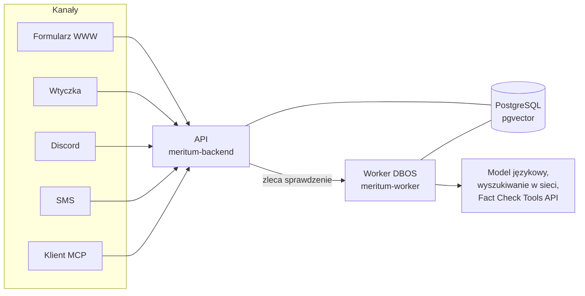

<p align="center">
  <picture>
    <source media="(prefers-color-scheme: dark)" srcset="assets/meritum-logo-dark.png">
    <source media="(prefers-color-scheme: light)" srcset="assets/meritum-logo-light.png">
    
  </picture>
</p>

# meritum-monorepo

Meritum sprawdza informacje dla obywatela. Wklejasz tekst albo link i dostajesz werdykt dla każdego twierdzenia, z dosłownymi cytatami ze źródeł. Prototyp powstaje na HackNation 2026 w konkursie MSZ „Prawdowid”.

To repozytorium nie zawiera kodu produktu. Łączy pozostałe repozytoria organizacji jako submoduły git przypięte do commitów i trzyma rzeczy wspólne: `docker-compose.yml` do uruchomienia całości, skrypty oraz zasady pracy w [AGENTS.md](AGENTS.md).

Spis treści: [co działa dziś](#co-działa-dziś) · [budowa](#jak-to-jest-zbudowane) · [repozytoria](#repozytoria) · [środowiska](#środowiska) · [uruchomienie lokalne](#uruchomienie-lokalne) · [dla jury](#dla-jury) · [praca w repozytoriach](#praca-w-repozytoriach)

## Co działa dziś

Każdy kanał wysyła to samo zapytanie do jednego API, więc to samo pytanie daje ten sam wynik.

| Kanał | Co potrafi | Gdzie |
|---|---|---|
| Formularz WWW | tekst, link, nagranie głosowe, zrzut ekranu; logowanie kontem Google albo Microsoft jest opcjonalne | prd i dev |
| Discord | komenda `/sprawdz` i „Sprawdź w Meritum” w menu wiadomości; wzmianki i wiadomości prywatne obsługuje osobny proces Gateway | prd i dev |
| Wtyczka do przeglądarki | przycisk „Sprawdź” pod postami na X, Facebooku, Instagramie, Reddicie i TikToku oraz okienko w popupie | paczki w Releases |
| Konektor MCP | narzędzia `check_claim` i `search_sources` dla aplikacji czatu AI | prd i dev |
| SMS | odpowiedź z werdyktem na SMS wysłany na numer bramki | tylko dev |

Poza kanałami działa panel personelu: kolejka spraw moderatora, konta, tematy wysokiego ryzyka, eksport dla analityka i strona ewaluacji pod `/panel/eval`.

Rzeczy w toku:

- Strona WWW zmienia wygląd ([epik #39](https://github.com/Meritum-HackNation2026/meritum-monorepo/issues/39)). Na `develop` frontendu są już nowy motyw i nowa belka ze stopką, więc widać je na dev. Strona główna, „Jak działa”, menu „Wygląd” i strona sprawdzenia są w budowie. Prd pokazuje poprzedni wygląd.
- SMS przechodzi przez telefon z Androidem i aplikację SMS Gateway for Android ([sms-gate.app](https://docs.sms-gate.app/)). Webhook jest zarejestrowany tylko dla dev, bo oba środowiska dzielą jeden telefon.
- Kosztu 1 000 zapytań jeszcze nie zmierzyliśmy ([#30](https://github.com/Meritum-HackNation2026/meritum-monorepo/issues/30)).
- Środowisko w GCP jest opisane w meritum-infra, ale nie jest wdrożone. Na hackathon wszystko działa na serwerze zespołu.

## Jak to jest zbudowane



API przyjmuje zapytanie, maskuje dane osobowe, liczy limity i zleca sprawdzenie workerowi przez kolejkę DBOS. Postęp i wynik klient czyta po identyfikatorze sprawdzenia albo ze strumienia SSE.

Worker wykonuje sprawdzenie jako jeden workflow. Pobiera stronę z linku albo zamienia nagranie na tekst, szuka w treści ukrytych poleceń i wyodrębnia najwyżej 5 twierdzeń. Dowodów szuka w korpusie, w sieci (tylko w domenach z katalogu źródeł) i wśród ocen fact-checkerów. Potem porównuje źródła z twierdzeniami, odrzuca cytaty, których nie ma dosłownie w tekście źródła, pisze odpowiedź i zapisuje przebieg.

Kontrakty danych, porty, adaptery i reguły werdyktu są w meritum-core, z którego korzystają API i worker. Model językowy, wyszukiwarkę i pozostałych dostawców wybiera konfiguracja.

Więcej: [sprawdzenie krok po kroku](https://github.com/Meritum-HackNation2026/meritum-docs/blob/main/docs/jak-dziala/sprawdzenie.md), [kanały](https://github.com/Meritum-HackNation2026/meritum-docs/blob/main/docs/kanaly.md) i [architektura](https://github.com/Meritum-HackNation2026/meritum-docs/tree/main/docs/architektura) w meritum-docs. Ta sama dokumentacja jest na [meritum-docs.pages.dev](https://meritum-docs.pages.dev), za logowaniem Cloudflare Access.

## Repozytoria

| Katalog | Repozytorium | Zawartość |
|---|---|---|
| `core/` | [meritum-core](https://github.com/Meritum-HackNation2026/meritum-core) | kontrakty, porty, adaptery, reguły domenowe, katalog źródeł |
| `backend/` | [meritum-backend](https://github.com/Meritum-HackNation2026/meritum-backend) | API w FastAPI i kanały wejściowe: WWW, Discord, SMS, MCP |
| `worker/` | [meritum-worker](https://github.com/Meritum-HackNation2026/meritum-worker) | workflowy DBOS: sprawdzenie, zasilanie korpusu, retencja, ewaluacja |
| `frontend/` | [meritum-frontend](https://github.com/Meritum-HackNation2026/meritum-frontend) | aplikacja webowa i panel personelu (React), serwowane przez nginx |
| `extension/` | [meritum-extension](https://github.com/Meritum-HackNation2026/meritum-extension) | wtyczka do przeglądarki (Manifest V3, WXT) |
| `mocks/` | [meritum-mocks](https://github.com/Meritum-HackNation2026/meritum-mocks) | makiety platform i makieta Discorda (Hono) |
| `infra/` | [meritum-infra](https://github.com/Meritum-HackNation2026/meritum-infra) | runnery CI, platforma na serwerze zespołu, Terraform dla GCP |
| `design-system/` | [meritum-design-system](https://github.com/Meritum-HackNation2026/meritum-design-system) | dokument produktowy, tokeny, komponenty, teksty interfejsu |
| `docs/` | [meritum-docs](https://github.com/Meritum-HackNation2026/meritum-docs) | dokumentacja (Zensical, Cloudflare Pages) |
| `marketing/` | [meritum-marketing](https://github.com/Meritum-HackNation2026/meritum-marketing) | deck, film i opis do zgłoszenia konkursowego |
| `org-profile/` | [.github](https://github.com/Meritum-HackNation2026/.github) | profil organizacji, formularze zgłoszeń, szablon PR |

Poza profilem organizacji repozytoria są na razie prywatne.

## Środowiska

| | prd (gałąź `main`) | dev (gałąź `develop`) |
|---|---|---|
| Aplikacja webowa | [meritum.gburek.app](https://meritum.gburek.app) | [meritum-dev.gburek.app](https://meritum-dev.gburek.app) |
| Dokumentacja API | [/api/docs](https://meritum.gburek.app/api/docs) | [/api/docs](https://meritum-dev.gburek.app/api/docs) |
| Stan usług | [/api/v1/health](https://meritum.gburek.app/api/v1/health) | [/api/v1/health](https://meritum-dev.gburek.app/api/v1/health) |
| Konektor MCP | `https://meritum.gburek.app/mcp` | `https://meritum-dev.gburek.app/mcp` |
| Discord | [zainstaluj „Meritum”](https://discord.com/oauth2/authorize?client_id=1573692006398693396) | [zainstaluj „Meritum dev”](https://discord.com/oauth2/authorize?client_id=1573690220782559332) |

Dev ma tylko frontend, backend i worker. Makiety i wtyczka wychodzą wyłącznie z `main`:

- makiety platform: [X](https://meritum-x.gburek.app), [Facebook](https://meritum-facebook.gburek.app), [Instagram](https://meritum-instagram.gburek.app), [Reddit](https://meritum-reddit.gburek.app), [TikTok](https://meritum-tiktok.gburek.app) i [Discord](https://meritum-discord.gburek.app),
- wtyczka: paczki dla Chrome, Edge i Firefoksa w [Releases meritum-extension](https://github.com/Meritum-HackNation2026/meritum-extension/releases).

Oba środowiska działają na serwerze zespołu (`dellpromaxgb10`) za tunelem Cloudflare i dzielą jeden kontener PostgreSQL. Każde ma własny schemat `app_<env>` i własną bazę DBOS, a schemat `corpus` jest wspólny i zapisuje do niego tylko worker prd. Worker nie ma publicznego adresu. Układ bazy, ról i kontenerów opisuje [README meritum-infra](https://github.com/Meritum-HackNation2026/meritum-infra/blob/main/README.md).

## Uruchomienie lokalne

Potrzebujesz Dockera z Compose 2.24 lub nowszym, gita i klucza SSH z dostępem do organizacji. Submoduły używają adresów SSH, a obrazy API i workera pobierają przy budowaniu prywatne meritum-core.

```bash
git clone --recurse-submodules git@github.com:Meritum-HackNation2026/meritum-monorepo.git
cd meritum-monorepo
ssh-add ~/.ssh/id_ed25519    # klucz z dostępem do organizacji
cp .env.example .env         # opcjonalnie: własne klucze
docker compose up --build
```

| Adres | Co |
|---|---|
| http://localhost:8080 | aplikacja webowa (nginx przekazuje `/api` do API) |
| http://localhost:8080/api/docs | dokumentacja API |
| http://localhost:8080/api/v1/health | test gotowości: baza, worker, brakujące zmienne |
| http://localhost:3000 | makiety: `/x/`, `/facebook/`, `/instagram/`, `/reddit/`, `/tiktok/`, `/discord/` |

Bez pliku `.env` system startuje na stubach i nic nie opuszcza komputera. Model językowy odpowiada wtedy z `config/llm-stub.json`, a embeddingi i transkrypcja też są stubami. Każda zmienna w [.env.example](.env.example) ma opis. Gdy brakuje klucza, `/api/v1/health` podaje jego nazwę, a sprawdzenie kończy się stanem „Problem techniczny” zamiast werdyktu.

Compose uruchamia PostgreSQL z obrazu meritum-infra (pgvector i polski słownik), workera, API, frontend i makiety. Proces Gateway Discorda jest w profilu `discord` i wymaga `MERITUM_DISCORD_BOT_TOKEN`:

```bash
docker compose --profile discord up --build
```

Test dymny uruchamia całość, czeka na gotowość i wysyła jedno sprawdzenie na stubie modelu. Działa tylko lokalnie, poza CI:

```bash
scripts/smoke.sh                 # zostawia system uruchomiony
SMOKE_DOWN=1 scripts/smoke.sh    # na końcu zatrzymuje compose
```

Samą konfigurację compose, bez kontenerów, sprawdza `scripts/check-compose.sh`.

## Dla jury

### Publiczne demo

Żaden z tych kroków nie wymaga konta ani kluczy.

1. Otwórz [meritum.gburek.app](https://meritum.gburek.app), wklej tekst albo link i kliknij „Sprawdź”.
2. Otwórz [makietę Discorda](https://meritum-discord.gburek.app) i wyślij to samo twierdzenie. Makieta woła to samo API co prawdziwy bot.
3. Jeśli masz konto Discord, [zainstaluj aplikację „Meritum”](https://discord.com/oauth2/authorize?client_id=1573692006398693396) i użyj `/sprawdz`.

Wtyczka jest opcjonalna. Pobierz paczkę z [Releases](https://github.com/Meritum-HackNation2026/meritum-extension/releases), rozpakuj ją, w `chrome://extensions` włącz „Tryb dewelopera” i wybierz „Załaduj rozpakowane”. Przycisk „Sprawdź” pojawi się pod postami na makietach platform.

Wyniki ewaluacji są w aplikacji pod `/panel/eval`. Administrator może dać jurorowi dostęp do odczytu [jednorazowym linkiem](https://github.com/Meritum-HackNation2026/meritum-backend/blob/develop/README.md#jednorazowy-link-jury-32). Zestaw referencyjny można też przeliczyć samemu poleceniem `uv run meritum-eval` z [meritum-worker](https://github.com/Meritum-HackNation2026/meritum-worker/blob/develop/README.md#ewaluacja).

### Gdzie przetwarzane są dane

| Co | Kto | Gdzie |
|---|---|---|
| API, worker, baza z zapisami sprawdzeń i korpusem | serwer zespołu | Polska |
| cały ruch HTTP publicznego demo | Cloudflare (tunel kończy TLS) | USA |
| model językowy | Claude Haiku 5.5 przez OpenRouter, tylko endpointy bez retencji danych | poza EOG |
| embeddingi, maskowanie danych osobowych, przesłane pliki | Google Cloud | `europe-central2` (Warszawa) |
| transkrypcja nagrań | Google Speech-to-Text v2 | multi-region `eu` |
| wyszukiwanie w sieci | Vertex AI Search | `global`, poza UE |
| oceny fact-checkerów | Google Fact Check Tools API | poza EOG |
| kanały | Discord, sms-gate.app | USA; sms-gate.app nie podaje regionu |
| logowanie (opcjonalne) | Google i Microsoft | USA |

Do modelu i do wyszukiwarek trafia tekst po zamaskowaniu danych osobowych. Pełny rejestr, razem z dostawcami opcjonalnymi, jest w [`copy/privacy.json`](https://github.com/Meritum-HackNation2026/meritum-design-system/blob/main/copy/privacy.json) w meritum-design-system (ADR-14).

### Bramki przed modelem

Maskowanie danych osobowych robi Google Sensitive Data Protection w regionie UE. Gdy bramka jest wyłączona, zostają wzorce telefonu, e-maila, PESEL-u i numeru dowodu, a log zapisuje pominięcie.

Wstrzyknięcia poleceń zawsze sprawdzają wzorce PL/EN z meritum-core, a treść użytkownika i źródeł trafia do modelu wyłącznie jako dane. Zewnętrzny klasyfikator (Model Armor albo Cloudflare Workers AI) jest opcjonalny.

Reranker fragmentów ma trzy adaptery w workerze i domyślnie jest wyłączony. Wyniki zostają wtedy w kolejności z wyszukiwarki. Dostawców, regiony i cenniki bramek opisuje [README meritum-worker](https://github.com/Meritum-HackNation2026/meritum-worker/blob/develop/README.md#bramka-klasyfikatora-wstrzyknięć).

### Koszty i limity

Koszt każdego sprawdzenia liczymy z tokenów i wywołań wyszukiwarki zapisanych w `CheckRecord`. Koszt 1 000 zapytań, koszt utrzymania kanałów i odsetek trafień w pamięci wyników podamy dopiero po pomiarze, z datą ([#30](https://github.com/Meritum-HackNation2026/meritum-monorepo/issues/30)). Pomiar robi się ręcznie, poza CI:

```bash
python scripts/measure_costs.py records.jsonl      # eksport CheckRecord, jeden rekord w wierszu
cd worker && uv run meritum-cost ../records.jsonl  # to samo podsumowanie z meritum-worker
```

Nagranie może mieć do 20 MiB i 10 minut. Plik i wynik sprawdzenia są usuwane po 30 dniach.

Sprawdzenia idą przez kolejkę DBOS z limitem współbieżności. API liczy limity na IP, kanał i region oraz próg oczekujących sprawdzeń. Ponad limitem odpowiada HTTP 429 z `Retry-After`, a awaria dostawcy kończy się stanem „Problem techniczny”. W żadnym z tych przypadków użytkownik nie dostaje werdyktu. Szacunek kosztu wdrożenia i plan skalowania są w [meritum-marketing](https://github.com/Meritum-HackNation2026/meritum-marketing/blob/main/docs/koszty-i-skalowanie.md).

## Praca w repozytoriach

Zasady dla ludzi i agentów AI, od zgłoszenia do scalenia, są w [AGENTS.md](AGENTS.md).

### Gałęzie i wdrożenia

W meritum-frontend, meritum-backend i meritum-worker zmiany idą przez PR do `develop`, a wydanie przez PR `develop` → `main`. W pozostałych repozytoriach PR idzie do `main`. Nie pushuj bezpośrednio do `develop` ani `main`: plan Free nie chroni gałęzi w repozytoriach prywatnych, więc pilnujemy tego sami.

Gałąź funkcji usuwaj po scaleniu (`gh pr merge --delete-branch`). Automatyczne usuwanie jest wyłączone, bo po PR `develop` → `main` skasowałoby `develop`.

Każde repozytorium aplikacji ma `.github/workflows/ci.yml`. Lint, typy, testy i build działają na runnerach GCP na każdej gałęzi. Po zielonym CI runner `dellpromaxgb10` wdraża `develop` na dev i `main` na prd, a potem sprawdza kontener przez `/api/v1/health` i zadanie `ping`. Testy wymagające kontaktu między usługami uruchamiamy tylko lokalnie.

### Sekrety i zależności

W każdym repozytorium gitleaks skanuje historię pushowanej gałęzi przy każdym pushu (`.github/workflows/secrets.yml`). Lokalnie ten sam skan blokuje push z sekretem. Włącz go raz po sklonowaniu:

```bash
brew install gitleaks && scripts/setup-git-hooks.sh
```

Fałszywy alarm dopisz z uzasadnieniem do `.gitleaks.toml`, zamiast pushować z `--no-verify`.

Dependabot otwiera w poniedziałki PR-y z wersjami drobnymi i poprawkowymi, jeden na ekosystem. Wersję meritum-core w backendzie i workerze podbija workflow w core.

### Submoduły

Submoduł wskazuje commit, nie gałąź. Zmiany w kodzie commituj i wypychaj w repozytorium danego submodułu, a tutaj tylko przesunięcie wskaźnika. Wszystkie wskaźniki na najnowszy `main` przesuwa skrypt, który od razu tworzy commit:

```bash
./scripts/update-submodules.sh
git push
```

Po sklonowaniu bez submodułów wystarczy `git submodule update --init`.
